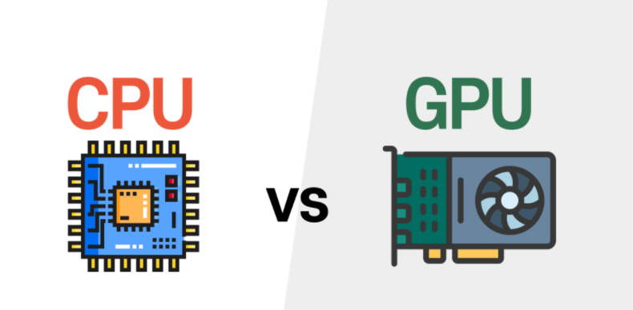
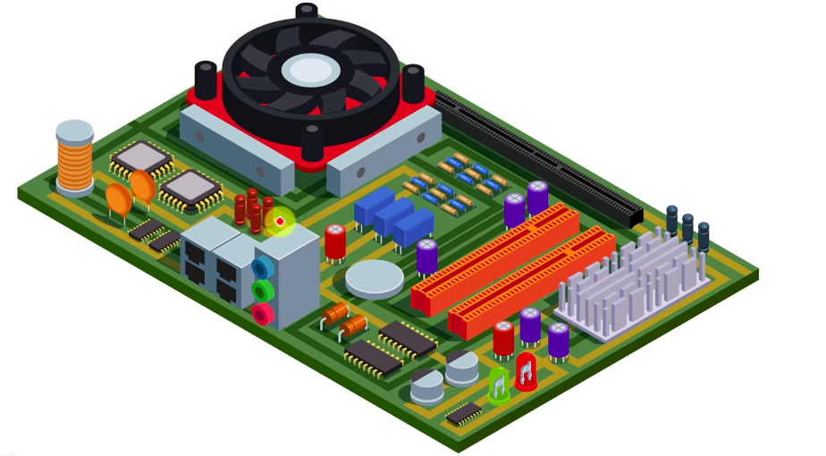
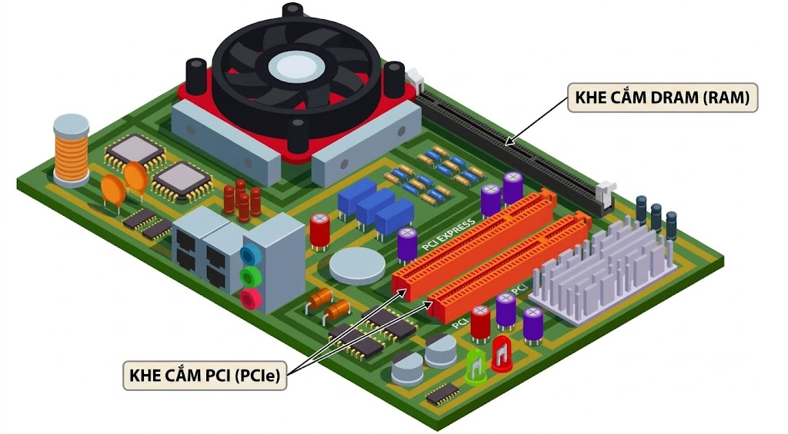
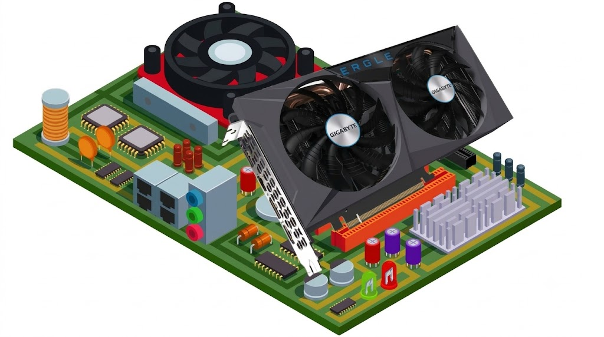
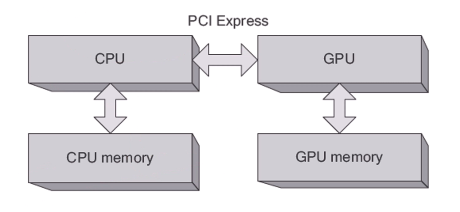
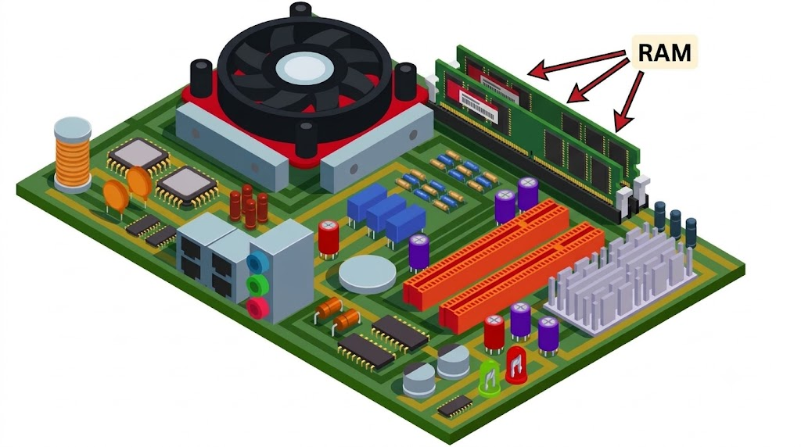
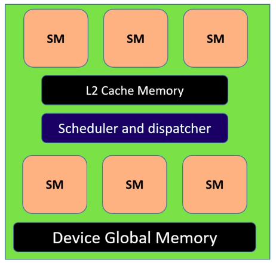
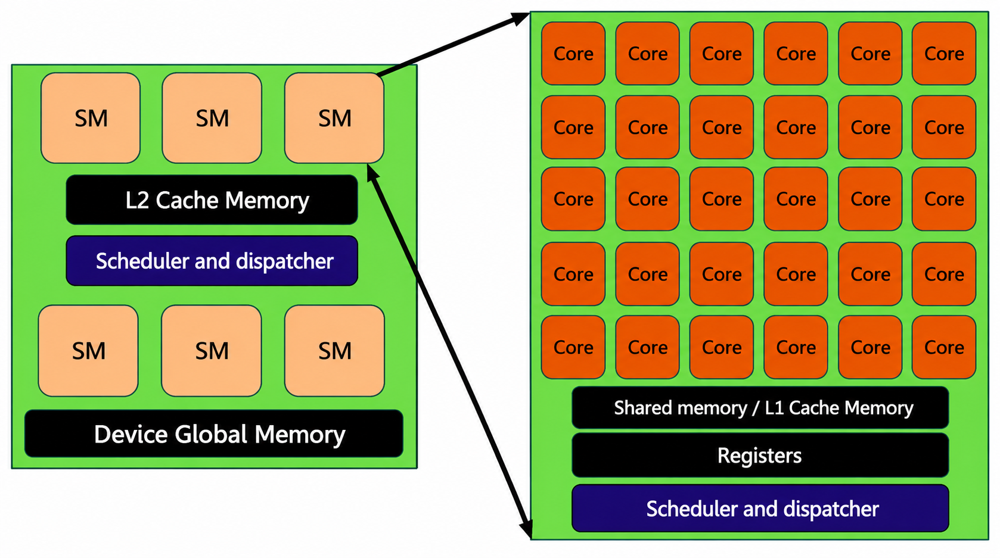
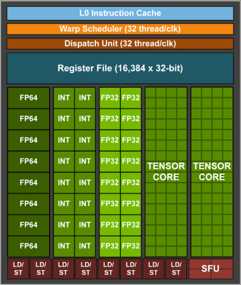

# Bài 1: GPU và CPU

## Đặt vấn đề

Để hiểu rõ kiến trúc phần cứng GPU, đặc biệt tập trung vào các thiết kế của NVIDIA thì ta hãy đặt ra câu hỏi:

> Liệu chúng ta không thể đơn giản viết một đoạn mã và chạy nó trên GPU để đạt hiệu suất tối ưu sao?

**Không!** Để tối ưu hóa hiệu năng của GPU, ta cần hiểu rõ từng thành phần phần cứng bên trong nó.

Để dễ hình dung hơn, hãy tưởng tượng một bác sĩ thực hiện ca phẫu thuật mà không có kiến thức toàn diện về giải phẫu con người. Nếu không có kiến thức đầy đủ, ca phẫu thuật sẽ gặp trục trặc. Tương tự, để khai thác GPU người ta phải am hiểu về phần cứng.

---

## 1. So sánh kiến trúc GPU và CPU


Từ 2 hình ảnh này, cả CPU và GPU dường như đều chứa các thành phần hoạt động tương tự nhau:
- Cả 2 đều chứa **DRAM** là bộ nhớ toàn cục.
- Cả 2 đều có các cấp độ bộ nhớ đệm (Cache) khác nhau:
  - CPU có 3 cấp độ bộ nhớ đệm: **L1, L2, L3**.
  - GPU được trang bị **2 cấp** bộ nhớ đệm, thực hiện các chức năng tương tự hoặc gần giống nhau, phục vụ các tác vụ tương tự như các tác vụ CPU.
- Tiếp theo, chúng ta có đơn vị **ALU** viết tắt của *Arithmetic and Logic Unit* (Đơn vị số học và logic). Bộ phận này chịu trách nhiệm thực thi các lệnh của bất kỳ ứng dụng nào trong CPU:
  - Trong CPU: Chúng ta chỉ có một số lượng hạn chế các đơn vị ALU.
  - Trong GPU: Chứa hàng trăm hoặc thậm chí hàng nghìn đơn vị tương tự, các đơn vị này được gọi là **lõi (cores)**.

Do có những điểm tương đồng là cả 2 đều có DRAM, đều có các cấp bộ nhớ đệm khác nhau, và cả 2 đều có ALU trong CPU và các lõi trong GPU.

---

## 2. Sự khác biệt giữa ALU của CPU và Lõi của GPU

Tại sao cả CPU và GPU đều có ALU thì sự khác biệt giữa chúng là gì?

Để giải quyết vấn đề này, chúng ta hãy xem xét ALU trong một **phép so sánh 1 đối 1 ("1 : 1")**:
- So sánh một ALU từ CPU với một lõi xử lý trong hệ thống GPU.

### Khái niệm "Powerful" (Mạnh mẽ) - Tốc độ (Speed)
Khi nói đến một ALU mạnh mẽ, chúng ta đang nói đến các thuộc tính như tốc độ:
- Các CPU hiện đại hoạt động ở tần số lên tới **3 GHz hoặc 4 GHz**.
- Mặt khác, GPU NVIDIA A100 ra mắt năm 2020 có tần số lõi dao động từ **765 MHz đến 1200 MHz**.
  - $1200 \text{ MHz} = 1.2 \text{ GHz}$, tức là chỉ bằng khoảng **1/4 tốc độ trung bình của CPU**.

### Mục đích thiết kế (Đa năng vs Chuyên dụng)
- Các đơn vị ALU trong CPU được thiết kế cho các tác vụ đa năng và thường tập trung vào việc thực thi các phép tính của **một luồng duy nhất thật nhanh chóng**.
- Mặt khác, các lõi GPU chuyên dụng hơn, thường được thiết kế để thực hiện các tác vụ cụ thể.

### Khả năng xử lý song song
- GPU được thiết kế để **xử lý song song**. Chúng được tối ưu hóa để xử lý nhiều luồng đồng thời, lý tưởng cho các tác vụ như dựng hình, đồ họa, trong đó 1 thao tác áp dụng song song cho nhiều phần tử.

---

## 3. Những khác biệt này ảnh hưởng đến hiệu năng của ứng dụng như thế nào?

Chúng ta hãy cùng nhau xem xét tác động hoặc ảnh hưởng của sự khác biệt về số lượng lõi xử lý đối với ứng dụng (ở đây là số lượng lõi GPU so với số ALU của CPU).

### Trường hợp 1: Các lệnh trong ứng dụng đều phụ thuộc lẫn nhau
Giả định các lệnh trong ứng dụng đều phụ thuộc lẫn nhau, nghĩa là mỗi lệnh đều phụ thuộc vào lệnh trước đó.

Để làm rõ điều này, chúng ta hãy soạn thảo một số hướng dẫn cho tình huống này. Bắt đầu với 3 lệnh riêng biệt, mỗi lệnh thực hiện một thao tác khác nhau:

```text
Add   R1, R2, R3
Mul   R4, R1, R5
Div   R6, R4, R7
```

**Chi tiết các bước thực hiện:**
1. Đầu tiên, lấy các giá trị $R2 + R3$ rồi lưu vào thanh ghi $R1$.
2. Tiếp theo, nhân giá trị $R1$ với $R5$ rồi lưu vào thanh ghi $R4$.
3. Rồi chia giá trị $R4$ với $R7$ rồi lưu vào thanh ghi $R6$.

**Biểu thức toán học tổng hợp:**
$$[(R2 + R3) \times R5] \div R7$$

```text
       +---------------- R4 ---------------+
       |                                   |
       |       +------- R1 ------+         |
       |       |                 |         |
 [ ( R2 + R3 ) * R5 ] / R7  ===> R6
     \_____/
        |
      Lệnh 1: Add  ---> Lưu kết quả vào R1
        |
        v
      Lệnh 2: Mul  ---> R1 * R5 ---> Lưu kết quả vào R4
        |
        v
      Lệnh 3: Div  ---> R4 / R7 ---> Lưu kết quả vào R6
```

#### Phân tích sự phụ thuộc dữ liệu:
Nếu bạn quan sát lệnh thứ 2, nó sử dụng $R1$ — cũng là thanh ghi đã được sử dụng trong lệnh trước đó là phép cộng. Điều này có nghĩa trước khi thực hiện phép nhân, bắt buộc phải chờ lệnh cộng thực hiện xong vì nó liên quan đến $R1$ (nơi lưu trữ của phép cộng).

Phương pháp xử lý này được gọi là **thực thi tuần tự (Sequential Execution)**, có nghĩa là các lệnh được thực hiện theo trình tự, chúng tiếp nối nhau thành một chuỗi:

```text
[ Lệnh 1: Add ]               [ Lệnh 2: Mul ]               [ Lệnh 3: Div ]
   R2 + R3                       R1 * R5                       R4 / R7
      |                             |                             |
      v                             v                             v
  Ghi vào R1 -----> (Đọc R1)    Ghi vào R4 -----> (Đọc R4)    Ghi vào R6
                   (Chờ Lệnh 1                   (Chờ Lệnh 2
                    hoàn tất)                     hoàn tất)
```

Trong ví dụ này, ta thấy để thực hiện phép tính như trên cần thực hiện lần lượt **3 lệnh chỉ dẫn**.

---

### Thắc mắc: Tại sao không tận dụng nhiều lõi để thực thi các lệnh này song song chỉ trong một bước?

Ngay cả khi có 3 lõi riêng biệt xử lý các phép cộng, nhân, chia, chúng cũng **sẽ không hoạt động đồng thời**:

```
+---------------------------------------------------------------+
|                              CPU                              |
|                                                               |
|  +-----------------------------+ +--------------------------+ |
|  |            ALU 1            | |          ALU 2           | |
|  |           R2 + R3           | |         R1 * R5          | |
|  |                             | |                          | |
|  |        [ĐANG XỬ LÝ]         | |  [BỊ CHẶN - CHỜ LỆNH 1]  | |
|  +-----------------------------+ +--------------------------+ |
|                                                               |
|  +-----------------------------+ +--------------------------+ |
|  |            ALU 3            | |          ALU 4           | |
|  |           R4 / R7           | |                          | |
|  |                             | |                          | |
|  |   [BỊ CHẶN - CHỜ LỆNH 2]    | |       [KHÔNG DÙNG]       | |
|  +-----------------------------+ +--------------------------+ |
+---------------------------------------------------------------+
```

Lệnh thứ 2 phải đợi lệnh thứ nhất, lệnh thứ 3 phải chờ lệnh thứ 2. 

Vì vậy, đối với các tác vụ đòi hỏi thực thi hàng ngàn chỉ thị mang tính tuần tự, kiến trúc phần cứng với số lượng nhỏ ALU như CPU là sự lựa chọn lý tưởng để tránh lãng phí tài nguyên, đặc biệt là nếu chúng có hàng ngàn sự phụ thuộc lẫn nhau.

- Điều này ta có một câu hỏi là liệu CPU có tối ưu cho quy trình như vậy hay không? Khi nào ta cần GPU?
  + Câu trả lời này nằm ở bản chất của các thao tác hoặc các chỉ thị.
  + Mặc dù kịch bản mà chúng ta thảo luận phù hợp với CPU nhưng GPU lại tỏa sáng nhất trong những tình huống khác, trong đó các câu lệnh bên trong một ứng dụng phải độc lập với nhau.
  + Ví dụ:
    ```text
    Add   R1, R2, R3
    Mul   R4, R5, R6
    Div   R7, R8, R9
    ```
    - Khi ta cộng R2 và R3 rồi lưu R1, phép nhân MUL bây giờ không còn phụ thuộc kết quả của phép Add.
    - Bây giờ R5 x R6 với kết quả lưu vào R4, như vậy có sự độc lập giữa chúng.
    - Nếu có nhiều lõi xử lí chúng ta có thể gán mỗi lệnh một lõi riêng biệt và thực thi chúng đồng thời. Điều này có thể xảy ra trên quy mô lớn.
  + Hãy tưởng tượng chúng ta có 1000 lệnh, mỗi lệnh chỉ cần một chu kì để thực thi. Trong kịch bản này, tất cả các lệnh sẽ được thực thi song song cùng một lúc trên 1000 lõi xử lí hoàn thành cùng nhau trong một chu kì.

```text
+--------+   +--------+   +--------+   +-------+   +-----+
|  Core  |   |  Core  |   |  Core  |   | LD/ST |   |     |
+--------+   +--------+   +--------+   +-------+   | SFU |
|  Core  |   |  Core  |   |  Core  |   | LD/ST |   |     |
+--------+   +--------+   +--------+   +-------+   +-----+
+--------+   +--------+   +--------+   +-------+   +-----+
|  Core  |   |  Core  |   |  Core  |   | LD/ST |   |     |
+--------+   +--------+   +--------+   +-------+   | SFU |
|  Core  |   |  Core  |   |  Core  |   | LD/ST |   |     |
+--------+   +--------+   +--------+   +-------+   +-----+
```

  + Tuy nhiên trong lệnh phụ thuộc, sẽ mất 1000 chu kì vì mỗi lệnh phải chờ đợi người tiền nhiệm hoàn thành nhiệm vụ.

```text
[((R1 + R2) + R3) + R4] ... + R1000
 \________________________________/
   Có 999 phép cộng được thực hiện
```

=> Như vậy, chúng ta có thể hiểu rằng CPU được thiết kế đặc biệt cho các hoạt động tuần tự. Ở đây nên hiểu rằng mỗi lệnh được phụ thuộc vào kết quả của lệnh trước đó. Mặt khác, khi xử lí các tác vụ chứa nhiều lệnh độc lập, GPU sẽ đảm nhiệm nhiều vai trò hơn. Ưu điểm của chúng là khả năng thực thi nhiều lệnh đồng thời trên nhiều lõi xử lí khác nhau.



=> Việc hiểu rõ sự khác biệt này rất quan trọng vì có một quan niệm sai lầm rằng GPU tốt hơn CPU. Mỗi cái đều có giá trị khi giải quyết một vấn đề cụ thể cho đúng mục đích thiết kế ra chúng.

---

## 4. Tìm hiểu cách CPU và GPU cùng tồn tại trong hầu hết các hệ thống

- Hình ảnh bo mạch chủ thông dụng có trong hầu hết các máy tính của chúng ta.



- Ở đây bạn có thể quan sát một chiếc quạt. Quạt này được thiết kế chuyên dụng để giữ cho CPU luôn mát và bảo vệ nó khỏi bị quá nhiệt.


- Đế CPU này giao tiếp với nhiều thành phần khác nhau thông qua một số loại kết nối, ví dụ ở đây có khe cắm DRAM, giao diện nguồn và đặc biệt có giao diện PCI.



- Giao diện PCI cần thiết vì nó cho phép kết nối với nhiều card, bao gồm GPU và mạng. Các card màn hình và card âm thanh được lắp đặt nơi cắm bất kì GPU nào trên giao diện này. Tại đây, giao diện PCI thiết lập mối liên kết trực tiếp thông qua các đường dẫn trên bo mạch chủ đến CPU. Vì vậy khi ta cắm GPU này với giao diện PCI, nó sẽ được kết nối với CPU. Cấu hình này thường được mô tả trong hầu hết các tài liệu khi nói về mối quan hệ giữa CPU và GPU.



- Như hình minh họa, bạn sẽ thấy CPU được kết nối với GPU thông qua giao diện PCI với CPU. Máy tính có CPU và bộ nhớ chính là DRAM. Tương tự, GPU có bộ nhớ đồ họa riêng biệt là VRAM.



- Thanh RAM của CPU được lắp trên khe cắm RAM và kết nối trực tiếp với CPU qua kênh bộ nhớ (memory channels), trong khi card GPU được gắn vào khe cắm PCIe và sử dụng bus bộ nhớ nội bộ riêng để truy xuất VRAM.



---

## 5. Thành phần chính cấu tạo nên GPU



- Khung màu xanh lá cây ở đây đại diện cho card GPU. Bên trong GPU này có một đơn vị hoặc thành phần quan trọng được gọi là Bộ xử lí đa luồng (stream multiprocessor), thường được viết tắt với tư cách là SM.



- Bên cạnh SM, nhiều cấp bộ nhớ khác nhau cũng có thể được tìm thấy trong GPU, chẳng hạn như bộ nhớ đệm L2 (L2 cache memory) và device global memory.
- Ngoài ra các thành phần như bộ lập lịch (scheduler and dispatcher) và bộ điều phối cũng hiện diện.



- Đi sâu vào SM, ta thấy nó được trang bị nhiều lõi xử lí được thiết kế cho các tác vụ cụ thể. Một số lõi xử lí này có thể được dành riêng để thực hiện các phép toán dấu phẩy động, trong khi những lõi khác thực hiện các phép toán số nguyên hay phép toán khác.
- Chúng ta sẽ xem xét GPU A100 được ra mắt vào năm 2020. Hình ảnh này thể hiện một phần nhỏ của một bộ xử lí đa luồng duy nhất.
- SM nằm bên trong GPU, L2 cache cũng nằm bên trong GPU nhưng L1 cache nằm bên trong mỗi SM. Ngoài ra, SM còn bao gồm bộ lập lịch, một bộ phận điều phối với nhiều thanh ghi khác nhau về mặt thực thi hoặc các đơn vị chức năng, SM khá đa dạng.
- Trong SM có các lõi tensor được thiết kế đặc biệt cho phép nhân ma trận, cùng với các nhân xử lý số thực (FP32 / FP64 Cores) và nhân số nguyên (INT32 Cores).
- Ngoài ra còn các đơn vị chức năng đặc biệt (SFU - Special Function Units) được thiết kế để xử lí các phép toán siêu việt chuyên biệt như hàm logarit hay các hàm lượng giác. Về mặt tương tác với bộ nhớ, SM tích hợp các đơn vị Load/Store (LD/ST Unit) chịu trách nhiệm thực thi các lệnh đọc (load) và ghi (store) dữ liệu vào bộ nhớ.
