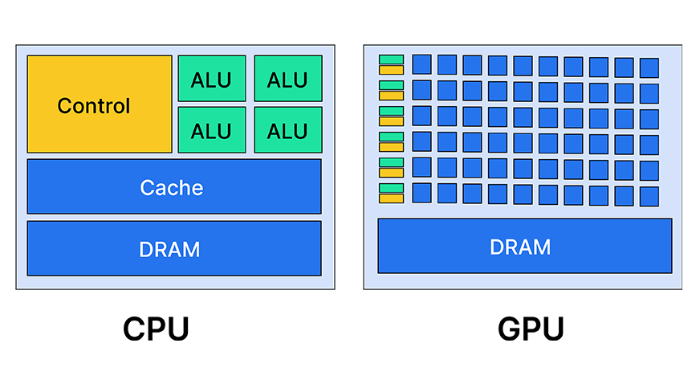

# Bài 1: GPU và CPU

## Đặt vấn đề

Để hiểu rõ kiến trúc phần cứng GPU, đặc biệt tập trung vào các thiết kế của NVIDIA thì ta hãy đặt ra câu hỏi:

> Liệu chúng ta không thể đơn giản viết một đoạn mã và chạy nó trên GPU để đạt hiệu suất tối ưu sao?

**Không!** Để tối ưu hóa hiệu năng của GPU, ta cần hiểu rõ từng thành phần phần cứng bên trong nó.

Để dễ hình dung hơn, hãy tưởng tượng một bác sĩ thực hiện ca phẫu thuật mà không có kiến thức toàn diện về giải phẫu con người. Nếu không có kiến thức đầy đủ, ca phẫu thuật sẽ gặp trục trặc. Tương tự, để khai thác GPU người ta phải am hiểu về phần cứng.

---

## 1. So sánh kiến trúc GPU và CPU



Từ 2 hình ảnh này, cả CPU và GPU dường như đều chứa các thành phần hoạt động tương tự nhau:
- Cả 2 đều chứa **DRAM** là bộ nhớ toàn cục.
- Cả 2 đều có các cấp độ bộ nhớ đệm (Cache) khác nhau:
  - CPU có 3 cấp độ bộ nhớ đệm: **L1, L2, L3**.
  - GPU được trang bị **2 cấp** bộ nhớ đệm, thực hiện các chức năng tương tự hoặc gần giống nhau, phục vụ các tác vụ tương tự như các tác vụ CPU.
- Tiếp theo, chúng ta có đơn vị **ALU** viết tắt của *Arithmetic and Logic Unit* (Đơn vị số học và logic). Bộ phận này chịu trách nhiệm thực thi các lệnh của bất kỳ ứng dụng nào trong CPU:
  - Trong CPU: Chúng ta chỉ có một số lượng hạn chế các đơn vị ALU.
  - Trong GPU: Chứa hàng trăm hoặc thậm chí hàng nghìn đơn vị tương tự, các đơn vị này được gọi là **lõi (cores)**.

Do có những điểm tương đồng là cả 2 đều có DRAM, đều có các cấp bộ nhớ đệm khác nhau, và cả 2 đều có ALU trong CPU và các lõi trong GPU.

---

## 2. Sự khác biệt giữa ALU của CPU và Lõi của GPU

Tại sao cả CPU và GPU đều có ALU thì sự khác biệt giữa chúng là gì?

Để giải quyết vấn đề này, chúng ta hãy xem xét ALU trong một **phép so sánh 1 đối 1 ("1 : 1")**:
- So sánh một ALU từ CPU với một lõi xử lý trong hệ thống GPU.

### Khái niệm "Powerful" (Mạnh mẽ) - Tốc độ (Speed)
Khi nói đến một ALU mạnh mẽ, chúng ta đang nói đến các thuộc tính như tốc độ:
- Các CPU hiện đại hoạt động ở tần số lên tới **3 GHz hoặc 4 GHz**.
- Mặt khác, GPU NVIDIA A100 ra mắt năm 2020 có tần số lõi dao động từ **765 MHz đến 1200 MHz**.
  - $1200 \text{ MHz} = 1.2 \text{ GHz}$, tức là chỉ bằng khoảng **1/4 tốc độ trung bình của CPU**.

### Mục đích thiết kế (Đa năng vs Chuyên dụng)
- Các đơn vị ALU trong CPU được thiết kế cho các tác vụ đa năng và thường tập trung vào việc thực thi các phép tính của **một luồng duy nhất thật nhanh chóng**.
- Mặt khác, các lõi GPU chuyên dụng hơn, thường được thiết kế để thực hiện các tác vụ cụ thể.

### Khả năng xử lý song song
- GPU được thiết kế để **xử lý song song**. Chúng được tối ưu hóa để xử lý nhiều luồng đồng thời, lý tưởng cho các tác vụ như dựng hình, đồ họa, trong đó 1 thao tác áp dụng song song cho nhiều phần tử.

---

## 3. Những khác biệt này ảnh hưởng đến hiệu năng của ứng dụng như thế nào?

Chúng ta hãy cùng nhau xem xét tác động hoặc ảnh hưởng của sự khác biệt về số lượng lõi xử lý đối với ứng dụng (ở đây là số lượng lõi GPU so với số ALU của CPU).

### Trường hợp 1: Các lệnh trong ứng dụng đều phụ thuộc lẫn nhau
Giả định các lệnh trong ứng dụng đều phụ thuộc lẫn nhau, nghĩa là mỗi lệnh đều phụ thuộc vào lệnh trước đó.

Để làm rõ điều này, chúng ta hãy soạn thảo một số hướng dẫn cho tình huống này. Bắt đầu với 3 lệnh riêng biệt, mỗi lệnh thực hiện một thao tác khác nhau:

```text
Add   R1, R2, R3
Mul   R4, R1, R5
Div   R6, R4, R7
```

**Chi tiết các bước thực hiện:**
1. Đầu tiên, lấy các giá trị $R2 + R3$ rồi lưu vào thanh ghi $R1$.
2. Tiếp theo, nhân giá trị $R1$ với $R5$ rồi lưu vào thanh ghi $R4$.
3. Rồi chia giá trị $R4$ với $R7$ rồi lưu vào thanh ghi $R6$.

**Biểu thức toán học tổng hợp:**
$$[(R2 + R3) \times R5] \div R7$$

```text
       +---------------- R4 ---------------+
       |                                   |
       |       +------- R1 ------+         |
       |       |                 |         |
 [ ( R2 + R3 ) * R5 ] / R7  ===> R6
     \_____/
        |
      Lệnh 1: Add  ---> Lưu kết quả vào R1
        |
        v
      Lệnh 2: Mul  ---> R1 * R5 ---> Lưu kết quả vào R4
        |
        v
      Lệnh 3: Div  ---> R4 / R7 ---> Lưu kết quả vào R6
```

#### Phân tích sự phụ thuộc dữ liệu:
Nếu bạn quan sát lệnh thứ 2, nó sử dụng $R1$ — cũng là thanh ghi đã được sử dụng trong lệnh trước đó là phép cộng. Điều này có nghĩa trước khi thực hiện phép nhân, bắt buộc phải chờ lệnh cộng thực hiện xong vì nó liên quan đến $R1$ (nơi lưu trữ của phép cộng).

Phương pháp xử lý này được gọi là **thực thi tuần tự (Sequential Execution)**, có nghĩa là các lệnh được thực hiện theo trình tự, chúng tiếp nối nhau thành một chuỗi:

```text
[ Lệnh 1: Add ]               [ Lệnh 2: Mul ]               [ Lệnh 3: Div ]
   R2 + R3                       R1 * R5                       R4 / R7
      |                             |                             |
      v                             v                             v
  Ghi vào R1 -----> (Đọc R1)    Ghi vào R4 -----> (Đọc R4)    Ghi vào R6
                   (Chờ Lệnh 1                   (Chờ Lệnh 2
                    hoàn tất)                     hoàn tất)
```

Trong ví dụ này, ta thấy để thực hiện phép tính như trên cần thực hiện lần lượt **3 lệnh chỉ dẫn**.

---

### Thắc mắc: Tại sao không tận dụng nhiều lõi để thực thi các lệnh này song song chỉ trong một bước?

Ngay cả khi có 3 lõi riêng biệt xử lý các phép cộng, nhân, chia, chúng cũng **sẽ không hoạt động đồng thời**:

```
+---------------------------------------------------------------+
|                              CPU                              |
|                                                               |
|  +-----------------------------+ +--------------------------+ |
|  |            ALU 1            | |          ALU 2           | |
|  |           R2 + R3           | |         R1 * R5          | |
|  |                             | |                          | |
|  |        [ĐANG XỬ LÝ]         | |  [BỊ CHẶN - CHỜ LỆNH 1]  | |
|  +-----------------------------+ +--------------------------+ |
|                                                               |
|  +-----------------------------+ +--------------------------+ |
|  |            ALU 3            | |          ALU 4           | |
|  |           R4 / R7           | |                          | |
|  |                             | |                          | |
|  |   [BỊ CHẶN - CHỜ LỆNH 2]    | |       [KHÔNG DÙNG]       | |
|  +-----------------------------+ +--------------------------+ |
+---------------------------------------------------------------+
```

Lệnh thứ 2 phải đợi lệnh thứ nhất, lệnh thứ 3 phải chờ lệnh thứ 2. 

Vì vậy, đối với các tác vụ đòi hỏi thực thi hàng ngàn chỉ thị mang tính tuần tự, kiến trúc phần cứng với số lượng nhỏ ALU như CPU là sự lựa chọn lý tưởng để tránh lãng phí tài nguyên, đặc biệt là nếu chúng có hàng ngàn sự phụ thuộc lẫn nhau.
